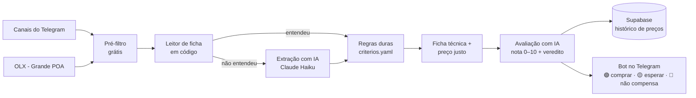

# Radar de Ofertas

Um bot que lê promoções em canais do Telegram e anúncios da OLX, entende cada oferta, compara com o que eu quero comprar e só me avisa quando **vale a pena**. O veredito vem com o motivo.

Comecei porque estava procurando um notebook. Acompanhava vários grupos de promoção, recebia centenas de mensagens por dia e quase nenhuma servia. Hoje o radar roda 24h, filtra tudo e me manda só o que passa nos meus critérios.

> **v1: notebooks.** Os critérios de compra ficam num arquivo (`criterios.yaml`), e generalizar para qualquer produto está no [roadmap](ROADMAP.md).

## O que ele faz



1. **Escuta** canais do Telegram (minha conta, só leitura) e busca anúncios da OLX a cada 2 h.
2. **Descarta de graça** o que não é notebook (celular, monitor, acessório…) com um pré-filtro em código.
3. **Lê a ficha técnica** em código quando o post segue um formato conhecido. A **IA só entra quando o código não entende**.
4. **Aplica as regras duras** (preço máximo, RAM, SSD, tela, GPU/CPU por nível). Dado ausente nunca reprova sozinho: vira incerteza para a IA pesar.
5. **Busca o preço justo** do modelo e a ficha completa, só para quem passou.
6. **A IA dá nota de 0 a 10 e um veredito** (comprar agora / esperar / não compensa), com o porquê.
7. **Usados da OLX** têm um cuidado extra: tabela de defeitos, preço de referência por mediana de usados parecidos ou depreciação por idade, e **alerta anti-golpe** quando o preço está fora da curva (abaixo de Q1 − 1,5×IQR) ou a IA vê sinal suspeito.
8. **Grava tudo no Supabase**, deduplica a mesma oferta postada em vários canais e avisa de novo quando o preço cai.

## Decisões que valem destacar

- **Código primeiro, IA quando precisa.** O pré-filtro e o leitor de ficha resolvem a maior parte das mensagens sem custo. A extração por IA custa cerca de **US$ 0,0005 por oferta** (~US$ 0,30/mês no volume atual).
- **Fontes plugáveis.** Toda fonte entrega o mesmo formato (`Oferta`). Adicionar um marketplace novo é escrever uma classe em `app/fontes/`, sem mexer no resto.
- **Critérios em YAML, não no código.** Mudar o que eu quero comprar é editar um arquivo. Componentes fora das listas aparecem numa tabela de calibração, e eu decido onde encaixar.
- **Calibrado com dados reais.** Antes de ligar a notificação, baixei mensagens antigas dos canais e revisei a tabela de aprovados e reprovados (`scripts/avaliar.py`). Também levantei o volume de notebooks por dia em quase 20 canais para escolher quais escutar (ver [ROADMAP](ROADMAP.md)).
- **Segurança.** Minha conta do Telegram só lê; as notificações saem por um bot separado. Segredos ficam fora do Git.
- **Testado.** 139 testes automatizados (`python -m pytest -q`).

## Como a IA foi usada para construir

Construí o projeto em etapas com **Claude Code**. Cada etapa do [ROADMAP](ROADMAP.md) virou uma entrega pequena, testada e depois calibrada com dados reais. Eu defini o problema, os critérios e as decisões (o que é golpe, quando vale esperar, quais canais valem o ruído), e o Claude Code escreveu e testou o código comigo.

## Stack

Python · Telethon (Telegram) · API da OLX via RapidAPI · Claude Haiku (Anthropic API) · Supabase (Postgres + REST) · Bot API do Telegram · Heroku (worker 24h) · pytest

## Estrutura

```
app/
  fontes/          telegram.py, olx.py (interface plugável em base.py)
  extracao/        pré-filtro, leitor de ficha em código, extração com IA
  avaliacao/       regras duras, usados/anti-golpe, avaliação com IA
  enriquecimento/  ficha técnica e preço justo
  notificacao/     mensagem com veredito, botões e resumo semanal
  processamento.py pipeline de uma oferta
  main.py          monitor 24h
scripts/           login, backfill, calibração, deploy
supabase/          migrações (tabela de ofertas, histórico de preços)
tests/             139 testes
criterios.yaml     o que eu quero comprar
```

## Rodar

Passo a passo (GitHub Codespaces, sem instalar nada): [docs/como-rodar.md](docs/como-rodar.md) · Deploy 24h: [docs/deploy-heroku.md](docs/deploy-heroku.md)

---

Feito por **Fernando Pech** · [LinkedIn](https://linkedin.com/in/fernandonunespech)
